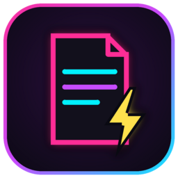
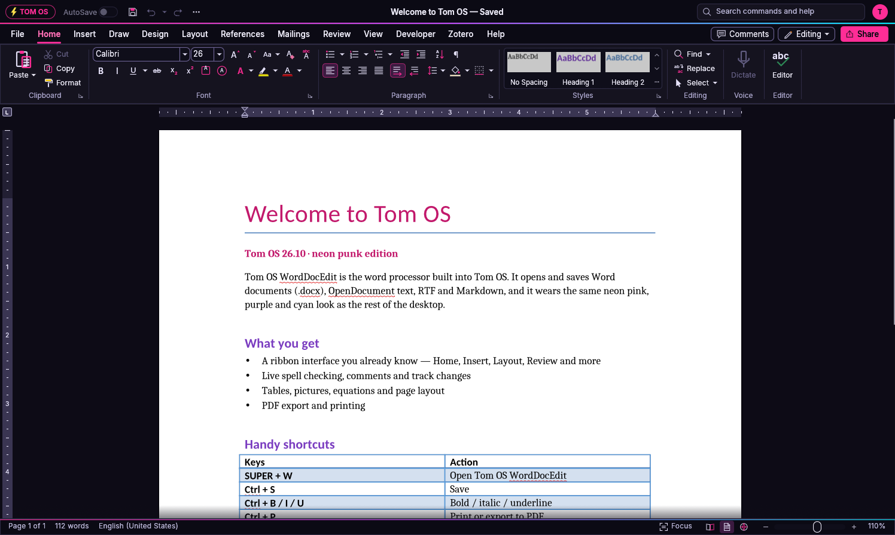
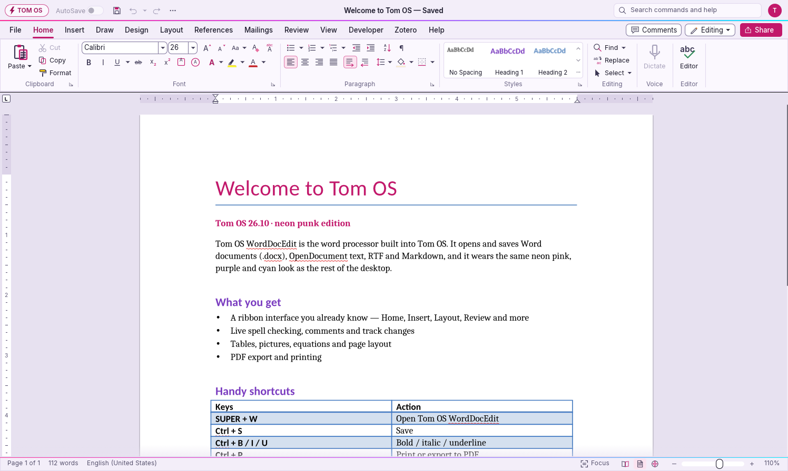
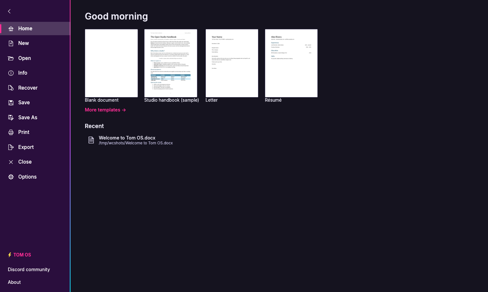
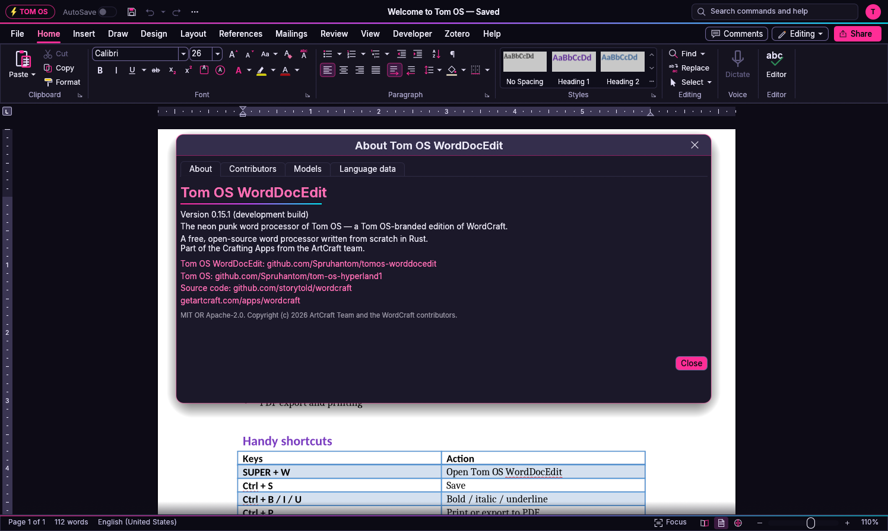
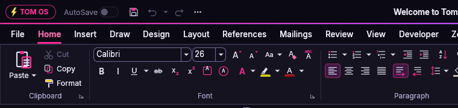

<p align="center"></p>

# Tom OS WordDocEdit

The neon punk word processor of **[Tom OS](https://github.com/Spruhantom/tom-os-hyperland1)**.
Tom OS WordDocEdit is a Tom OS-branded edition of
[WordCraft](https://github.com/storytold/wordcraft), the free, open-source
word processor written from scratch in Rust. It keeps everything WordCraft
can do (Word `.docx`, OpenDocument, RTF, Markdown, comments, track changes,
tables, equations, PDF export) and gives the interface the same neon pink,
purple and cyan look as the Tom OS desktop, login screen and Quickshell bar.



## What's different from WordCraft

- **Neon dark theme by default.** Night-black title and status bars, a
  deep-violet ribbon, neon pink (`#FF2D96`) for the selected tab, checked
  buttons, focus rings, switches and the Share button. Light and System
  themes are still in File › Options.
- **Tom OS light theme.** Lavender-white surfaces with deep magenta
  accents, for daytime use.
- **TOM OS badge** (lightning bolt + "TOM OS") at the start of the title
  bar. Click it for About.
- **Neon rules** in Tom OS colours (pink → purple → cyan) under the title
  bar, above the status bar and down the File page sidebar, like the Tom OS
  bar frame.
- **Rounder corners and neon glow.** Dialogs, menus and pop-ups have
  12 / 10 pt corners, a faint pink edge and a pink glow in the dark theme.
- **File page.** A neon marker on the open page and a Tom OS tag.
- **New name and icon.** Window titles read "… - Tom OS WordDocEdit", with
  a new neon page-and-bolt icon in every size.
- **No upstream update prompts.** The startup update check is off, so
  stock WordCraft never replaces this edition. Help › Check for Updates
  still works if you want it.
- The community (Discord) button in the title bar is off by default. You
  can turn it back on in Options.

Full details and the colour table are in
[docs/TOMOS-THEME.md](docs/TOMOS-THEME.md).

## Screenshots

| Editor — light theme | File page |
|---|---|
|  |  |

| About | Title bar |
|---|---|
|  |  |

All screenshots are real captures of this build, opening
[docs/sample-welcome-to-tom-os.docx](docs/sample-welcome-to-tom-os.docx).

## Build and run

You need Rust **1.95 or newer** (`rustup update stable`) and, on Linux, the
usual GUI libraries (Wayland/X11, fontconfig, GTK 3 for file dialogs).

```bash
git clone https://github.com/Spruhantom/tomos-worddocedit
cd tomos-worddocedit
cargo run --release -p wordcraft            # starts Tom OS WordDocEdit
cargo run --release -p wordcraft -- file.docx
```

The binary is still called `wordcraft` and the app id is still
`ai.storyteller.wordcraft`, so packaging scripts, file associations and
WordCraft's control channel (`--control <port>`, see
[docs/control-protocol.md](docs/control-protocol.md)) work unchanged.
`packaging/linux/` builds `.deb`/`.rpm` packages with the Tom OS name and
icon.

### On Tom OS

Tom OS opens it with **SUPER + W**. To swap it in for the stock WordCraft
package, build it with `cargo build --release -p wordcraft` and copy
`target/release/wordcraft` over `/usr/bin/wordcraft`, then copy
`assets/app-icon/hicolor` into `/usr/share/icons/hicolor` and
`packaging/linux/ai.storyteller.wordcraft.desktop` into
`/usr/share/applications`.

## Credits and licence

Tom OS WordDocEdit is based on **WordCraft 0.15.1** by the ArtCraft team and
the WordCraft contributors (imported from
[storytold/wordcraft@ef35d79](https://github.com/storytold/wordcraft/commit/ef35d79cb81ea1067de0cf80e6e7cd7b1cf9489c)).
The upstream README is kept at
[docs/WORDCRAFT-README.md](docs/WORDCRAFT-README.md).

Like WordCraft, it is dual-licensed under [MIT](LICENSE-MIT) or
[Apache-2.0](LICENSE-APACHE), at your option. See [NOTICE](NOTICE) and
[ATTRIBUTION.md](ATTRIBUTION.md). Tom OS WordDocEdit is not affiliated with
or endorsed by the ArtCraft team or Microsoft.
